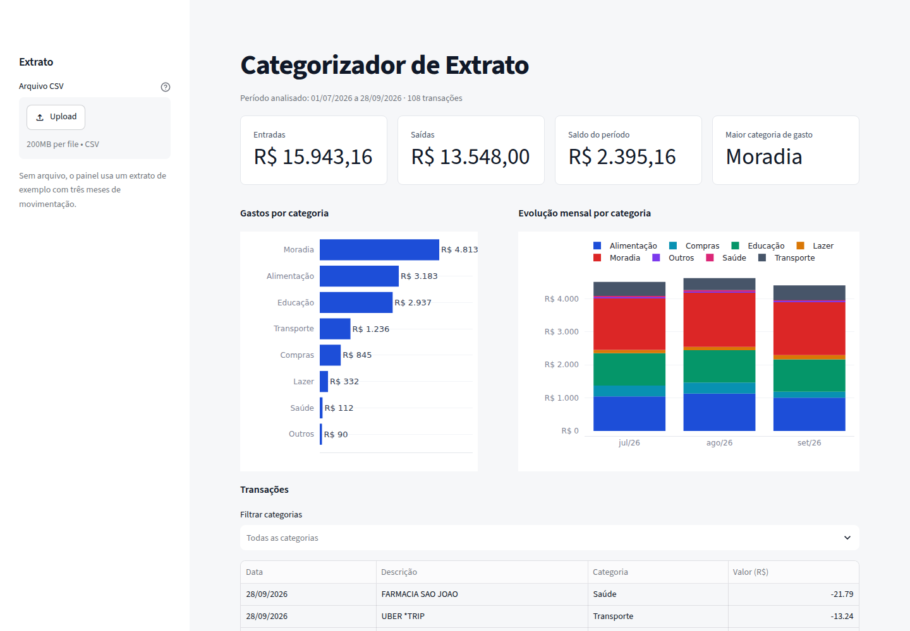

# Categorizador de Extrato

Painel em **Python + Streamlit** que recebe um extrato bancário em CSV, classifica cada transação por categoria de forma automática e apresenta a distribuição dos gastos e a evolução mês a mês.



## Funcionalidades

- Importação de extrato em CSV com validação de colunas e descarte de linhas inválidas
- Categorização automática por regras de texto, tolerante a acentos e maiúsculas
- Indicadores de entradas, saídas, saldo do período e principal categoria de gasto
- Gráfico de gastos por categoria e evolução mensal empilhada
- Filtro de transações por categoria e exportação do extrato já categorizado

## Como a categorização funciona

Cada categoria tem uma lista de palavras-chave. Antes da comparação, a descrição é normalizada (minúsculas, sem acentos). As palavras-chave são testadas **da mais longa para a mais curta**, o que resolve conflitos comuns — por exemplo, `MERCADO LIVRE` é classificado como *Compras*, e não como *Alimentação* por conter a palavra "mercado".

As regras ficam em `categorizador.py`, isoladas da interface, o que facilita testar e estender.

## Estrutura

```
app.py                  interface (Streamlit + Plotly)
categorizador.py        leitura do CSV, regras e categorização
tests/                  testes automatizados (pytest)
sample_data/            extrato fictício de três meses para demonstração
.streamlit/config.toml  tema visual
```

## Como executar

```bash
pip install -r requirements.txt
streamlit run app.py
```

Sem enviar arquivo, o painel carrega o extrato de exemplo. Para usar um extrato próprio, o CSV precisa conter as colunas `data` (dd/mm/aaaa), `descricao` e `valor` (negativo para saídas).

## Testes

```bash
pytest
```

## Stack

Python 3.10+, Streamlit, Pandas, Plotly e pytest.

## Próximos passos

- Edição das regras de categorização pela própria interface
- Identificação automática de gastos recorrentes (assinaturas)
- Leitura direta de arquivos OFX exportados pelos bancos
